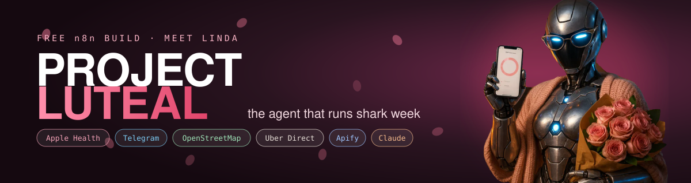
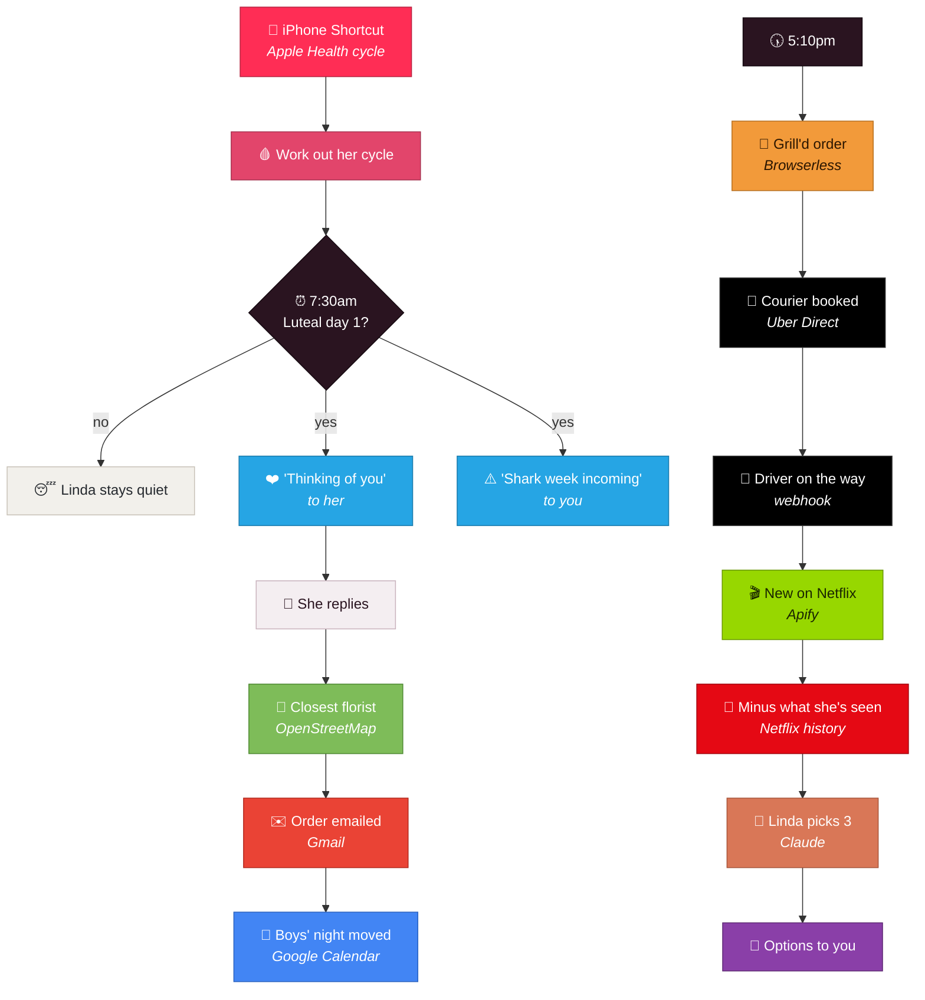
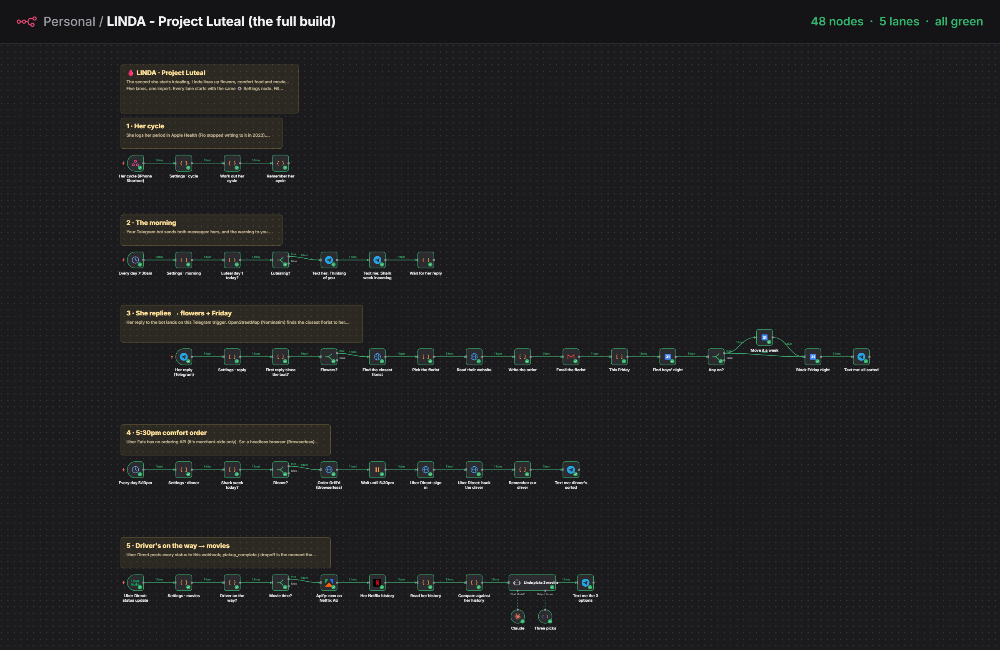

<p align="center">
  
</p>

<p align="center">
  <b>Linda reads her cycle from Apple Health. The day she starts lutealing, Linda sends<br>
  "Thinking of you ❤️", orders flowers from the closest florist, moves your Friday night<br>
  with the boys, fires off her comfort order at 5:30 and has three movies ready<br>
  by the time the driver's on the way.</b>
</p>

<p align="center">
  
  
  
  
  
  
  
</p>

---

This is what lands in Telegram on luteal day 1. A real run, straight off the demo workflow:

```
LINDA → her    7:30   Thinking of you ❤️
her → LINDA    7:41   aw thanks babe 🥹

LINDA → you    7:30   ⚠️ Caution: Shark week incoming. Show up.

LINDA → you    7:42   💐 12 pink roses ordered from the closest florist.
                      Landing before 4:30pm.
                      📅 Boys' night moved to next Friday. You're on duty. No excuses.

LINDA → you    5:42   🍿 Movie night. Give her these three:
                      💗 Comfort: The Notebook
                      😂 Funny: 21 Jump Street
                      🧠 Brain off: Shrek
                      Options, not homework.
```



---

## The canvas

<p align="center">
  
</p>

---

## Two workflows

| | File | What it is |
|---|---|---|
| 🩸 | `workflows/project-luteal.json` | **The build.** Five lanes on one canvas, one import |
| 🎬 | `workflows/project-luteal-DEMO.json` | One straight line you can **run end to end right now**, no waiting for her cycle |

**The five lanes:**

| Lane | Trigger | What happens |
|---|---|---|
| 🩸 Her cycle | Webhook | Her iPhone Shortcut posts her last period start. Linda works out luteal day 1 and remembers it |
| ❤️ The morning | 7:30am | If today's the day: "Thinking of you ❤️" to her, "Shark week incoming" to you |
| 💐 She replies | Telegram | Closest florist found and emailed the order. Friday boys' night moved a week, the night blocked out |
| 🍔 5:30pm | 5:10pm | Her Grill'd favourite ordered as a pickup, then an Uber Direct courier booked to her door |
| 🍿 On the way | Webhook | The driver's "on the way" triggers Apify, her Netflix history, and Linda's three picks |

**Fails safe.** Read-only calls (Apify, her Netflix history, the Uber sign-in, Claude) retry
three times. Anything that **spends or sends** (the Grill'd order, booking the courier, the
florist email, every Telegram message) never retries, so a flaky network can't double-order
her dinner. The florist search gives up in seconds and falls back to your usual florist.

**No database to set up.** Linda remembers her cycle, whether she's replied and which driver is
yours in n8n's own *workflow static data*. It persists between runs of an active workflow.

### The demo workflow is not faked where it doesn't have to be

Hit **Run it now** and it really sends the Telegram messages, really **waits for a real reply**
(reply in the chat and it carries on), really searches OpenStreetMap for the closest florist,
really emails the order (to your own inbox in the demo), really scrapes what's trending on
Netflix with Apify and really asks Claude to pick. Only the parts that would spend money or need
her phone are stubbed: Apple Health, Google Calendar, the Grill'd checkout and the courier. Each
stub returns exactly what the real node returns, and says so in its first line.

---

## What's real, and the workarounds where it can't be

Most automation demos quietly aren't. Here's the honest split.

**Genuinely real, no key needed:**
- **Closest florist** — [OpenStreetMap](https://www.openstreetmap.org) via its Nominatim search.
  Real shops, real coordinates, free, about a second. If it's slow it gives up in seconds and
  uses your fallback florist, so the run never hangs. If the shop lists an email Linda uses it, otherwise she
  reads it off their website, otherwise she falls back to your usual florist.

**Real, needs your own key or login:**
- **Messages** — a Telegram bot. Free, and her reply comes straight back into the workflow.
  Prefer SMS? Swap the Telegram nodes for Twilio; nothing else changes.
- **The order email** — Gmail.
- **Boys' night** — Google Calendar. Anything this Friday with "boys" in it moves seven days, and
  the invite update emails everyone.
- **New movies** — Apify, running a JustWatch scraper for what's trending on Netflix AU. A run of
  30 titles costs about **US$0.03**, and the node carries a hard spend cap.
- **The picks** — Claude, as an n8n AI Agent with a structured output, so it always comes back as
  exactly one comfort, one funny and one brain-off.
- **The courier** — [Uber Direct](https://developer.uber.com/docs/deliveries/overview), Uber's real
  delivery API. Its sandbox has a robot courier that walks a delivery through every status, so
  you can test the "on the way" trigger (`pickup_complete` / `dropoff`) without a real driver. Going live needs an Uber Direct account.

**No API exists, so here's the workaround:**
- **Flo / period tracking apps** — Flo stopped writing to Apple Health in 2023. She logs her
  period in **Apple Health**, and an iPhone Shortcut reads it (see below).
- **Uber Eats** — there's **no consumer ordering API**. Uber's Eats APIs are merchant-side only.
  So the food is ordered by a headless browser (**Browserless**) that reorders her Grill'd favourite
  as a pickup, and Uber Direct does the delivery. The selectors are text-based; check them once
  against the site before you trust it with your card.
- **Netflix history** — Netflix has no API. She downloads it: *Account → Profile → Viewing
  activity → Download all*, and you drop the CSV into a Google Sheet. Linda reads the sheet's CSV link
  (*File → Share → Publish to web → CSV*). Format example: `optin/public/sample-netflix-viewing-activity.csv`.
- **"Places the order" with the florist** — florists don't have APIs either. Ring yours once and
  leave a card on file, then "please charge the card you have on file" in the email is true.

---

## The iPhone Shortcut (her phone, 5 minutes)

1. **Shortcuts → Automation → New → Charger → Is Connected → Run Immediately.**
2. Add **Find Health Samples**: Type *Menstrual Flow*, sort by *Start Date*, *Latest First*, limit 1.
3. Add **Get Contents of URL**: your `linda-cycle` webhook URL, Method *POST*, Request Body *JSON*:
   - `last_period_start` → the sample's *Start Date* (format `yyyy-MM-dd`)
   - `avg_cycle_days` → `28` (or her real average)
   - `secret` → the `shortcut_secret` from the ⚙️ Settings node
4. Done. It runs whenever she plugs her phone in.

> **Why the charger and not a 3am timer?** Apple locks Health data about 10 minutes after the
> phone locks, so an overnight Shortcut reads nothing. Plugging in happens with the phone unlocked.

---

## Running it

**You'll need:** a recent n8n (self-hosted or Cloud) with the AI Agent node, and the
**Apify node** (`@apify/n8n-nodes-apify`). On n8n Cloud it's a verified node, so just search
"Apify" in the nodes panel. Self-hosted: *Settings → Community nodes → Install* →
`@apify/n8n-nodes-apify`. Install it **before** importing, or the Apify node comes in as a
blank "?" node.

1. **Import both workflows** into n8n.
2. **Connect your credentials**: Telegram, Gmail, Google Calendar, Apify, Anthropic. Every one in
   the files reads `REPLACE_ME`. Nothing real ships in this repo.
3. **Fill in the ⚙️ Settings nodes.** There's one at the start of each lane (a lane can't read
   another lane's nodes), so fill in all five. Her Telegram chat id: she messages your bot once,
   then read it from `https://api.telegram.org/bot<TOKEN>/getUpdates`.
4. **Point the two webhooks**: the Shortcut posts to `linda-cycle`, and Uber Direct's webhook
   (in the Uber Direct dashboard) points at `linda-uber-status`. Her replies come in through
   the Telegram trigger, which registers itself when you activate.
5. **Swap the placeholders**: her work location (it ships pointing at a café on Oxford St,
   Leederville), her home address for the courier, your Grill'd store address, and the Uber
   Direct customer id, client id and secret.
6. **Activate.**
7. **Want to see it first?** Open the DEMO workflow and hit **Run it now**.

> ⚠️ Telegram only lets a bot have one way of receiving messages. The full build's Telegram
> trigger sets a webhook on your bot, and the demo reads replies by polling. Use a separate bot for
> the demo, or deactivate the full build while you play with it.

---

## The opt-in page

`optin/` is the page this repo was shared from: a static page plus one serverless function that
saves a signup and hands back this link. Every table has RLS on with no policies, the service key
never leaves the server, signups are rate-limited per IP and globally, IPs are stored hashed and
every field is length-capped.

---

<p align="center"><sub>MIT. Built by <a href="https://myceliumai.com.au">Mycelium AI</a> in Perth · follow the builds on Instagram at <a href="https://www.instagram.com/aaronautomates/">@aaronautomates</a>.<br>She's not mad. She's just disappointed.</sub></p>
